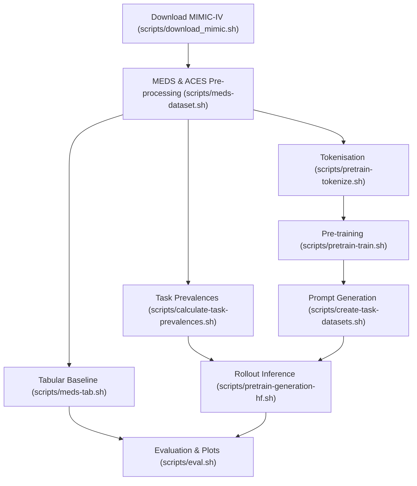

# Quantifying the Silent Failure Modes of Generative Electronic Health Record Models

[](https://www.python.org/downloads/)
[](https://github.com/astral-sh/uv)
[](https://github.com/Medical-Event-Data-Standard/meds)
[](https://github.com/som-shahlab/es-aces)
[](LICENSE)

Official repository to reproduce the data pre-processing, model pre-training, autoregressive rollout inference, tabular baseline comparisons, and statistical evaluation presented in the paper:

> **Quantifying the Silent Failure Modes of Generative Electronic Health Record Models**
> Simon Ellershaw, Anoop D. Shah, Richard Dobson, Christopher Tomlinson
> [Abstract](https://openreview.net/forum?id=JUd8c2Efv5)

---

## Overview

Generative foundation models for Electronic Health Records (EHRs) have shown significant promise for zero-shot clinical outcome prediction by autoregressively sampling future patient trajectories. However, evaluating their true predictive validity is complicated by unmeasured error rates in generated timelines and the methodological choices used to handle those failures.

This repository provides the official, end-to-end reproducible pipeline to quantitatively evaluate patient trajectory error rates, their underlying failure modes, and their downstream impact on clinical performance metrics. It provides direct empirical comparisons between:

1. **Natural Language Autoregressive Models**: Continual pre-training and generative rollout forecasting over chronological clinical narratives, fine-tuned from a general-domain Google Gemma 3 (270M) checkpoint.
2. **Structured Medical Code Models**: Autoregressive transformers trained from scratch (Gemma 3 270M architecture) with a custom vocabulary over structured [Medical Event Data Standard (MEDS)](https://github.com/Medical-Event-Data-Standard/meds) tokens.
3. **Tabular Discriminative Baselines**: Supervised XGBoost models trained on multi-window tabularised features via [MEDS-TAB](https://github.com/Medical-Event-Data-Standard/meds-tab).

### Clinical Evaluation Tasks

All cohort definitions, observation windows, and prediction targets are extracted from **MIMIC-IV** and **MIMIC-IV-ED** using [ACES](https://github.com/som-shahlab/es-aces):
- **In-Hospital Mortality** (`in_hospital_mortality`)
- **Hospital Length of Stay $\leq 7$ Days** (`hospital_length_of_stay_leq_7_days`)
- **30-Day Post-Discharge Mortality** (`hospital_post_discharge_30_day_mortality`)
- **ED-to-Hospital Admission** (`ed_to_hospital_admission`)
- **ED 72-Hour Reattendance** (`ed_72hr_reattendance`)

---

## Repository Structure

The repository is modularised into four primary directories:

```
├── mimic_struct_predict/       # Core Python library
│   ├── preprocessing/          # Data conversion, transforms, ACES tasks, & prevalence estimation
│   │   ├── aces_task_definitions/ # YAML cohort extraction rules for 5 clinical tasks
│   │   ├── meds/               # PhysioNet downloader, pre-MEDS, and MEDS transform stages
│   │   └── calculate_task_prevalences.py # Empirical task label prevalence computation
│   ├── models/                 # Generative autoregressive modelling pipeline
│   │   ├── config/             # Hydra configs (tokenize, train, create_task_datasets, generative_inference_hf)
│   │   ├── tokenize.py         # Tokenisation & vocabulary creation
│   │   ├── train.py            # Language model pre-training with Accelerate
│   │   ├── create_task_datasets.py # Task prompt & observation dataset construction
│   │   ├── generative_inference_hf.py # Parallel multi-GPU autoregressive trajectory rollouts
│   │   └── utils/              # Data collators, text serializers, and pre-processing helpers
│   ├── evals/                  # Integrated statistical evaluation & publication plotting
│   │   ├── rollout_delta.py    # Relative AUROC / Brier score deltas vs XGBoost (10k bootstraps)
│   │   ├── error_rates.py      # Format adherence & failure-mode distribution analysis
│   │   ├── gt_trajectory_lengths.py # Ground-truth future trajectory length distributions
│   │   ├── dataset_count.py    # Cohort, event, and token count statistics
│   │   ├── training_details.py # Runtime and training dynamics from TensorBoard logs
│   │   ├── event_config_to_latex.py # Converts MEDS event configs to camera-ready LaTeX
│   │   └── plot_style.py       # Publication typography, Tab10 palettes, and layout standards
│   └── debug/                  # Cohort and tokenised dataset inspection tools
│       ├── med_output.py       # Renders sample MEDS patient records as Markdown
│       ├── aces_output.py      # Renders sample ACES task cohorts as Markdown
│       ├── pretrain_output.py  # Decodes tokenised pre-training datasets for visual verification
│       └── task_output.py      # Decodes task prompt datasets for verification
├── scripts/                    # End-to-end SLURM orchestration scripts
│   ├── setup_uv.sh             # Compiles CUDA kernels & synchronises virtual environment
│   ├── download_mimic.sh       # Downloads MIMIC-IV / demo from PhysioNet
│   ├── meds-dataset.sh         # Converts raw data to MEDS & extracts ACES cohorts
│   ├── calculate-task-prevalences.sh # Computes calibration task prevalences
│   ├── meds-tab.sh             # Tabularises MEDS records & trains XGBoost baselines
│   ├── pretrain-tokenize.sh    # Pre-training tokenisation
│   ├── pretrain-train.sh       # Launches multi-GPU language model pre-training
│   ├── create-task-datasets.sh # Generates task prompt datasets for rollout evaluation
│   ├── pretrain-generation-hf.sh # Parallel multi-GPU autoregressive trajectory rollouts
│   ├── eval.sh                 # Executes statistical evaluation & figure generation
│   ├── config.sh               # Central path & environment configuration
│   └── tensorboard.sh          # Launches TensorBoard server for experiment tracking
├── pyproject.toml              # Dependencies and build configuration (via uv)
└── uv.lock                     # Deterministic lockfile
```

---

## Environment Setup & Requirements

### Prerequisites
- **Operating System**: Linux (x86_64)
- **HPC Workload Manager**: SLURM
- **Python**: `>=3.11, <3.13` managed via [`uv`](https://docs.astral.sh/uv/)
- **CUDA**: CUDA 12.2+ toolkit and drivers
- **Hardware**:
  - **GPU**: NVIDIA H100 (for pre-training) or A100 (for multi-GPU rollout inference)
  - **Memory**: 64 GB – 512 GB RAM depending on the pipeline stage

### 1. Environment Variables Configuration

Create a `.env` file in the repository root containing your credentials and paths:

```bash
export MIMIC_USER="<your_physionet_username>"
export MIMIC_PASSWORD="<your_physionet_password>"
export HF_TOKEN="<your_huggingface_user_access_token>"
export SCRATCH_DIR="</path/to/high_speed_scratch_directory>"
```

Then load the environment and shared project configurations:

```bash
# Choose dataset scale: 'false' for full MIMIC-IV v2.2, 'true' for MIMIC-IV Demo
export DEMO=false

source .env
source scripts/config.sh
```

> [!TIP]
> **Reproducing with the Demo Dataset**:
> Setting `export DEMO=true` configures the pipeline to use the lightweight MIMIC-IV demo dataset (`mimic-iv-demo` and `mimic-iv-ed-demo`). This allows rapid verification of the complete pipeline with minimal compute and storage.

### 2. Python Virtual Environment Setup

Because custom CUDA kernels (such as `flash-attn` and `causal-conv1d`) are compiled against the host CUDA environment, build the virtual environment on an HPC GPU node:

```bash
sbatch \
    --partition gpu_partition \
    --gres=gpu:1 \
    --constraint=h100 \
    --nodes=1 \
    --ntasks=12 \
    --mem=512G \
    --time=60 \
    --chdir=$(pwd) \
    --export=ALL,SCRATCH_DIR,HF_TOKEN,DEMO \
    --output=$SCRATCH_DIR/../logs/setup_uv/%j.out \
    scripts/setup_uv.sh
```

Alternatively, on an interactive GPU shell:
```bash
bash scripts/setup_uv.sh
```

---

## Step-by-Step Reproduction Pipeline

All pipeline steps can be executed sequentially via SLURM. Resource allocations (partitions, memory, walltime) reflect safe upper bounds on an HPC cluster and may be tuned to your institutional cluster.



---

### Step 1: Data Download

Downloads the MIMIC-IV clinical database (or demo dataset if `DEMO=true`) directly from PhysioNet:

```bash
sbatch \
    --partition cpu_partition \
    --time=10:00:00 \
    --mem=2G \
    --chdir=$(pwd) \
    --export=ALL,SCRATCH_DIR,HF_TOKEN,MIMIC_USER,MIMIC_PASSWORD,DEMO \
    --output=$SCRATCH_DIR/../logs/download_mimic/%j.out \
    scripts/download_mimic.sh
```

---

### Step 2: Data Pre-processing (MEDS & ACES)

Executes `pre_MEDS`, runs the MEDS transformation pipeline (`ETL.yaml`), and applies ACES cohort extraction rules across all clinical tasks:

```bash
sbatch \
    --partition cpu_partition \
    --time=1:00:00 \
    --ntasks=1 \
    --cpus-per-task=32 \
    --mem=256G \
    --chdir=$(pwd) \
    --export=ALL,SCRATCH_DIR,HF_TOKEN,DEMO \
    --output=$SCRATCH_DIR/../logs/meds-dataset/%j.out \
    scripts/meds-dataset.sh
```

---

### Step 3: Compute Task Prevalences

Calculates empirical task label prevalences across the training cohort shards and outputs `$TASK_PREVALENCES_PATH` (`task_prevalences.json`). This calibration metadata is required during generative rollout inference and evaluation:

```bash
sbatch \
    --partition cpu_partition \
    --time=0:30:00 \
    --ntasks=1 \
    --cpus-per-task=16 \
    --mem=64G \
    --chdir=$(pwd) \
    --export=ALL,SCRATCH_DIR,HF_TOKEN,DEMO \
    --output=$SCRATCH_DIR/../logs/task-prevalences/%j.out \
    scripts/calculate-task-prevalences.sh
```

*(Note: Can also be executed interactively in under a minute via `bash scripts/calculate-task-prevalences.sh`.)*

---

### Step 4: Tabular Baseline Training (MEDS-TAB)

Extracts aggregated multi-window time-series features and trains supervised XGBoost models via Hydra sweeps:

```bash
sbatch \
    --partition cpu_partition \
    --time=1-00:00:00 \
    --nodes=1 \
    --cpus-per-task=124 \
    --mem=950G \
    --chdir=$(pwd) \
    --export=ALL,SCRATCH_DIR,HF_TOKEN,DEMO \
    --output=$SCRATCH_DIR/../logs/meds-tab/%j.out \
    scripts/meds-tab.sh
```

Trained models and validation predictions will be stored under `$MEDS_TAB_OUTPUT_MODEL_DIR`.

---

### Step 5: Generative Model Pre-training

Models are trained under two distinct modalities:
- **`natural_language`**: Continual pre-training of Gemma 3 270M on flattened, time-stamped textual narratives.
- **`structured`**: Training an autoregressive transformer from scratch over structured MEDS code sequences.

#### 5.1 Tokenisation
Tokenises the MEDS datasets and constructs the vocabulary:

```bash
# Set mode to 'natural_language' or 'structured'
export MODE="natural_language"

sbatch \
    --partition cpu_partition \
    --time=0:20:00 \
    --ntasks=1 \
    --cpus-per-task=32 \
    --mem=256G \
    --chdir=$(pwd) \
    --export=ALL,SCRATCH_DIR,HF_TOKEN,DEMO \
    --output=$SCRATCH_DIR/../logs/pretrain-tokenize/%j.out \
    scripts/pretrain-tokenize.sh $MODE
```

Repeat for `export MODE="structured"`.

#### 5.2 Model Training
Launches distributed pre-training with Hugging Face `accelerate` and Liger kernels:

```bash
sbatch \
    --partition gpu_partition \
    --time=2-12:00:00 \
    --gres=gpu:1 \
    --constraint=h100 \
    --ntasks=1 \
    --cpus-per-task=18 \
    --mem=64G \
    --chdir=$(pwd) \
    --export=ALL,SCRATCH_DIR,HF_TOKEN,DEMO \
    --output=$SCRATCH_DIR/../logs/pretrain-train/%j.out \
    scripts/pretrain-train.sh $MODE
```

#### 5.3 Monitoring Training
Training logs and metrics can be monitored via TensorBoard:

```bash
bash scripts/tensorboard.sh
```

Forward the server port locally to inspect learning curves:
```bash
ssh -NL 8000:localhost:8000 <remote_hostname>
```

---

### Step 6: Autoregressive Rollout Inference

Upon completion of pre-training, locate the saved model checkpoints inside your scratch directory (located at `$SCRATCH_DIR/training/<mode>/pretraining/<timestamp>/final_model`).

Export the paths to your trained checkpoints:

```bash
export NL_MODEL_DIR="$SCRATCH_DIR/training/natural_language/pretraining/<timestamp>/final_model"
export STRUCT_MODEL_DIR="$SCRATCH_DIR/training/structured/pretraining/<timestamp>/final_model"
```

#### 6.1 Create Task-Specific Prompt Datasets
Extract patient trajectories up to the index prediction time for each ACES task:

```bash
export MODE="natural_language"
export MODEL_DIR="$NL_MODEL_DIR"
```
or
```bash
export MODE="structured"
export MODEL_DIR="$STRUCT_MODEL_DIR"
```

```bash
# For Natural Language:
sbatch \
    --partition cpu_partition \
    --time=4:00:00 \
    --ntasks=1 \
    --cpus-per-task=64 \
    --mem=512G \
    --chdir=$(pwd) \
    --export=ALL,SCRATCH_DIR,HF_TOKEN,DEMO \
    --output=$SCRATCH_DIR/../logs/create-task-datasets/%j.out \
    scripts/create-task-datasets.sh $MODE $MODEL_DIR
```

#### 6.2 Execute Multi-GPU Rollouts
Performs parallel autoregressive generative forecasting across GPUs:

```bash
export MODE="natural_language"
export MODEL_DIR="$NL_MODEL_DIR"
export FILE="cpt"
```
or
```bash
export MODE="structured"
export MODEL_DIR="$STRUCT_MODEL_DIR"
export FILE="pt"
```

```bash
sbatch \
    --partition gpu_server \
    --time=1-12:00:00 \
    --gres=gpu:4 \
    --constraint=a100 \
    --ntasks=1 \
    --cpus-per-task=28 \
    --mem=128G \
    --chdir=$(pwd) \
    --export=ALL,SCRATCH_DIR,HF_TOKEN,DEMO \
    --output=$SCRATCH_DIR/../logs/pretrain-generation/%j.out \
    scripts/pretrain-generation.sh $MODE $MODEL_DIR $FILE --split held_out
```

---

### Step 7: Statistical Evaluation & Figure Generation

Once rollouts and tabular baseline predictions are complete, execute the evaluation pipeline:

```bash
sbatch \
    --partition cpu_partition \
    --time=1:00:00 \
    --ntasks=1 \
    --cpus-per-task=32 \
    --mem=32G \
    --chdir=$(pwd) \
    --export=ALL,SCRATCH_DIR,HF_TOKEN,DEMO \
    --output=$SCRATCH_DIR/../logs/eval/%j.out \
    scripts/eval.sh "$NL_MODEL_DIR" "$STRUCT_MODEL_DIR"
```

*(Note: May also be run locally on a CPU node: `bash scripts/eval.sh "$NL_MODEL_DIR" "$STRUCT_MODEL_DIR"`.)*

#### Generated Artefacts & Paper Tables
All figures (formatted with publication typography, Tab10 colour palettes, and column-width constraints) and LaTeX tables are written to `$EVAL_PLOTS_DIR` (`$SCRATCH_DIR/eval_plots`):

| File | Description | Paper Reference |
| :--- | :--- | :--- |
| `rollout_delta/delta_auroc_rollout.png` | Relative $\Delta$ AUROC vs XGBoost (10,000 bootstrap iterations) | Main Results Figure |
| `rollout_delta/delta_brier_score_rollout.png` | Relative $\Delta$ Brier Score vs XGBoost | Main Results Figure |
| `rollout_delta/relative_metrics_*.tex` | Camera-ready LaTeX table of performance deltas | Main Results Table |
| `rollout_delta/rollout_dropped_percentages.tex`| Trajectory drop percentages across tasks | Failure Analysis Table |
| `error_rates/rollout_error_rates.png` | Format error rates broken down by failure reason | Failure Mode Analysis |
| `error_rates/rollout_error_samples.md` | Concrete examples of generated syntax and schema errors | Qualitative Analysis |
| `gt_trajectory_lengths/gt_trajectory_lengths.png` | Token length distribution of future trajectories | Empirical Context |
| `dataset_counts/dataset_counts.md` | Cohort sizes, event counts, and token counts | Cohort Summary Table |
| `training_details/training_runtimes.md` | Training runtimes and final evaluation perplexities | Implementation Details |

---

## Resource & Compute Requirements

| Stage | Script | Hardware | Estimated Time (Full MIMIC-IV) |
| :--- | :--- | :--- | :--- |
| Virtual Env Sync | `scripts/setup_uv.sh` | 1× GPU (H100/A100), 512 GB RAM | ~15–30 min |
| Raw Data Download | `scripts/download_mimic.sh` | 1× CPU, 2 GB RAM | ~2–4 hours |
| MEDS & ACES ETL | `scripts/meds-dataset.sh` | 32× CPU, 256 GB RAM | ~45–60 min |
| Task Prevalences | `scripts/calculate-task-prevalences.sh` | 16× CPU, 64 GB RAM | ~2–5 min |
| MEDS-TAB (XGBoost) | `scripts/meds-tab.sh` | 124× CPU, 950 GB RAM | ~12–18 hours |
| Tokenisation | `scripts/pretrain-tokenize.sh` | 32× CPU, 256 GB RAM | ~15–20 min |
| Model Pre-training | `scripts/pretrain-train.sh` | 1× H100 (80GB), 64 GB RAM | ~2.5 days per model |
| Task Prompts | `scripts/create-task-datasets.sh` | 64× CPU, 512 GB RAM | ~2–4 hours |
| Rollout Inference | `scripts/pretrain-generation-hf.sh` | 4× A100 (80GB), 128 GB RAM | ~24–36 hours per model |
| Statistical Eval | `scripts/eval.sh` | 32× CPU, 32 GB RAM | ~30–45 min |

---

## Citation & Contact

If you find this codebase or our paper useful in your research, please cite:

```bibtex
@inproceedings{
    ellershaw2026quantifying,
    title={Quantifying the Silent Failure Modes of Generative Electronic Health Record Models},
    author={Simon Ellershaw and Anoop D. Shah and Richard Dobson and Christopher Tomlinson},
    booktitle={The Third Workshop on GenAI for Health: Agentic Systems, Clinical Trust, and Future Potential},
    year={2026},
    url={https://openreview.net/forum?id=JUd8c2Efv5}
}
```
Corresponding Author: simon.2.ellershaw@kcl.ac.uk

## Licence

This project is licenced under the terms of the [MIT Licence](LICENSE).
